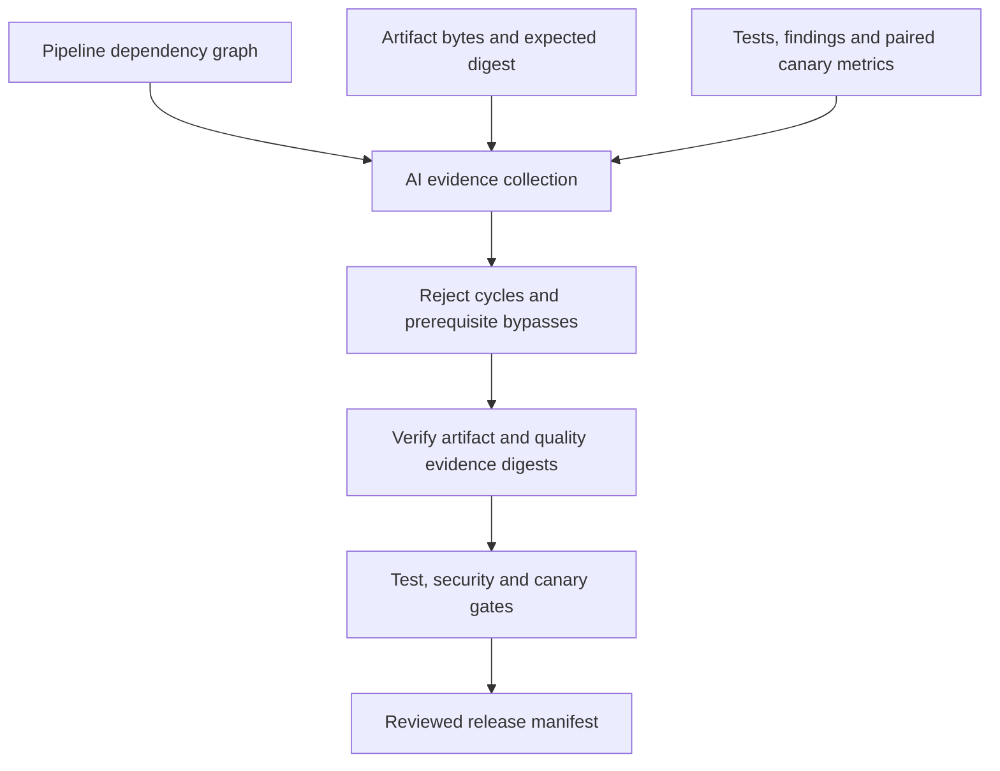
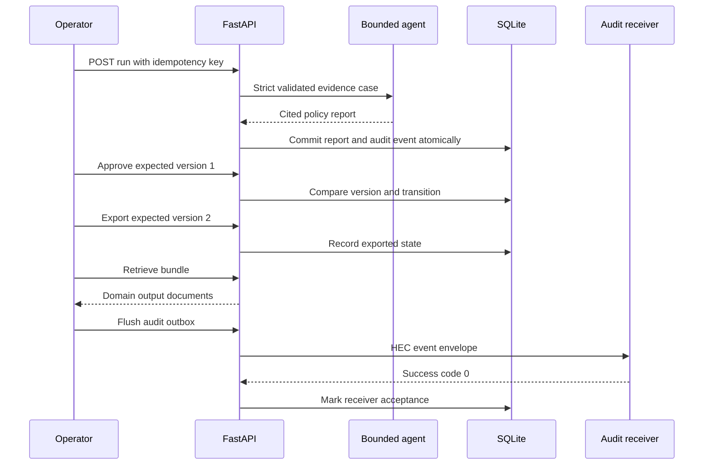

# Architecture

## Domain data flow

Graph validation rejects cycles and unknown dependencies. Builds must depend on test and scan evidence, and canaries must depend on a build. Quality reports include the artifact digest so a passing report from a different artifact cannot authorize export.

## API and persistence

Every workflow command checks the current version inside a BEGIN IMMEDIATE transaction. Competing requests with one idempotency key commit one report. Reusing that key with different input returns HTTP 409. Agent inference happens outside the transaction, so simultaneous retries can perform duplicate read-only model calls while persistence remains consistent.

The outbox offers at-least-once delivery. A crash after receiver acceptance and before the local acknowledgment can resend an event. Consumers can deduplicate by event ID. Reports and their input evidence are immutable after creation. Corrected evidence requires a new run.

## Trust boundaries

Pydantic validates request records before the model sees them. The agent receives evidence as data and can select only remaining probe names. Missing probes or invalid model responses prevent approval. Human approval exports documents for subsequent review. Kubernetes manifests are returned as text and remote infrastructure actions require an external operator or controller.

Metrics have bounded decision labels and contain no service identifiers. The audit sender exports workflow metadata. SQLite contains the full captured domain evidence and needs appropriate backup and access controls when real records are supplied.
